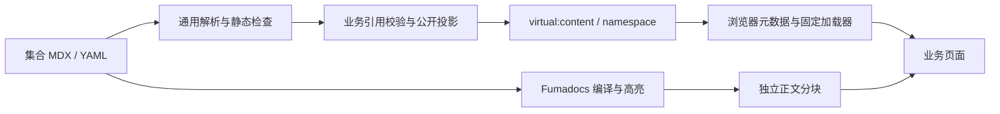

# Website 通用内容渲染

Website 的仓库内容通过通用 Fumadocs 编译链路接入 SPA。每个业务集合独立定义字段、公开投影和引用语义，编译、资源处理及正文加载不依赖 About。当前使用者是 About；后续 Website 栏目可以注册新的 namespace。

_最后更新：2026-10-13_

## 边界与数据流

`apps/web/build/content/` 是 Node 构建侧：解析 MDX/YAML、检查静态作者语法、验证资源路径、生成公开虚拟模块。`apps/web/build/collections.ts` 汇总注册集合，Vite 和 `content:check` 共用该列表。`apps/web/source.config.ts` 显式定义 Fumadocs 集合与编译 preset。

业务定义实现 `ContentDefinition`：namespace、root、文件分类/schema、作者组件属性契约及 `project(entries)`。通用引擎先解析全部文件，业务投影再校验跨引用；公开元数据与正文 import 不包含草稿。未注册文件使检查失败。图片资源采用有 src/alt/width/height 的 ImageRef 形态，不把任意业务 src 字段当作本地资源。

资源只从内容根 assets 目录导出；检查 realpath、存在性与路径边界。草稿独占资源不公开，公开内容共享使用的资源可以公开。内容目录不作为整个 public 目录复制。

开发期文件变化经同一校验后更新注册表并刷新页面。错误通过 Vite overlay 呈现，修复后恢复。构建配置变化遵循 Vite 自身的重启流程；生成目录不参与根测试 watcher。

## 浏览器与 UI

`apps/web/src/content/store.ts` 管理固定正文加载器，共享进行中的 Promise、缓存成功结果、移除失败以支持重试。`useContent` 在切换 id 或重试时立即呈现 loading，并隔离旧请求和卸载后的结果。

浏览器自身可能缓存失败的原生 import；移除应用 Promise 不能清除这个缓存。正文错误态除普通重试外提供重新加载当前页面，恢复整份 document 的模块状态，保留当前地址。不能只用可再次成功的测试 loader 推定网络失败恢复；需要在真实浏览器阻断 chunk 请求后验证恢复入口。

`apps/web/src/content/mdx.tsx` 提供可扩展组件映射。`packages/components/src/content/` 提供无路由/API 依赖的 CodeBlock、ContentImage、Callout、ContentProse。路由链接、业务按钮和资源 URL 由 Web 集合适配器注入。全局主题、ExUI CSS 和 ExMessage 宿主继续由既有应用入口持有。

高亮在构建期完成；浏览器不加载 MDX 编译器、Node 文件系统或高亮引擎。普通代码块从编译 transformer 接收原始文本，复制只作用于当前块。源码与维护记录见 `packages/components/src/content/SOURCES.md`。

## About 适配

`apps/web/build/about/` 持有社区、项目、成员、Media 与捐赠 schema，固定页要求和引用图。`apps/web/src/content/about/` 适配注册表、语义目标和资源 URL；`apps/web/src/pages/AboutUs/` 持有页面布局、栏目目录、成员 Modal、Media 筛选、捐赠展示与阅读位置。

About 入口及正文分别懒加载。成员只拥有正文 id，不创建个人路由；简介 Modal 不改变 URL。阅读位置按 Router location key 保存于模块内有限 Map，离开 About 再后退仍能恢复，页面刷新不持久化该状态。位置由 scroll 事件记录；离开时不再读取 window.scrollY，因为目的页 DOM 已可能缩短文档并将位置压缩，cleanup 再保存会覆盖原阅读位置。

首页由 `AboutHome.tsx` 组合背景 Hero 与品牌叙事布局。`AboutHomeHero.tsx` 暂用 Rifling 911 加入页的首张图片和相同 HalftoneDots 参数，标题、引言与简介叠在渐变遮罩上。图片先显示，再检查 WebGL2 并懒加载半调组件；WebGL 不可用时保留原图，图片失败时保留纯色背景与文案。半调设置 `speed=0`，不持续绘制，像素预算限制为 200 万。

Hero 在正常文档流中占满顶栏下方的首屏，圆角图片背景与页面背景上的箭头分为两行，之间留有间距，箭头下缘距视口底部 1rem；短视口或放大页面时文案可以撑开 Hero。正文从第二屏开始。下方为社区文字入口、项目与理念并列、团队横向展开、Media 与历程并列，最后是全宽捐赠入口。理念直接渲染首页完整 MDX，加载与失败恢复入口位于该区。其余六个栏目从现有注册表取得路由与缺省文案；社区块不预留图片，其他五个栏目的图片独立于链接，未提供或加载失败均为同尺寸普通占位。

捐赠栏目使用固定 `/aboutus/donations` 路由。介绍正文来自 `donations.mdx`，渠道与昵称/日期清单来自 `donations/items.yaml`，公开投影后交给 `Donations.tsx` 展示。清单沿用独立 meta 集合且禁用 Macro，不作为正文 import 暴露；否则 Fumadocs 的 frontmatter export 会把子条目 draft 原始字段送入浏览器。实际构建测试同时检查注册表与所有正文 chunk 均无草稿昵称、渠道及独占二维码资源。页面不处理支付或自动查询捐赠记录。

首页不挂载 About 栏目导航或面包屑；旧 Icon Shader 的 `AboutHero.tsx` 与 `hero/` 文件不由首页导入。前进导航使用 h1 入口焦点；无外圈的底部箭头链接到故事网格的 `about-content`，普通激活平滑滚动并将键盘焦点交给该区域，不改变当前 URL，减少动态效果模式使用即时定位。箭头只在顶栏下方可见且标签页位于前台时轻微上下移动；悬停、键盘聚焦或系统要求减少动态效果时保持静止。该 id 兼容旧 hash，并按顶栏高度留出滚动边距。首页静态布局已包含该区域，阅读位置初始化不等待理念 MDX，否则延迟加载完成会覆盖用户已进行的箭头滚动。子页仍等待正文就绪，浏览器后退仍由原有 location key 机制恢复阅读位置。

子页的 `AboutNavigation` 根据当前页面元数据在栏目栏左侧渲染面包屑，右侧保留栏目链接或手机目录。正文不再重复面包屑；详情页的父栏目保持 `aria-current="location"`。长面包屑允许换行，目录按钮保留自身宽度。About 标题统一使用 ExUI 粗体 token；`AboutBody` 的局部样式同时覆盖页面正文与通过 Portal 展示的成员正文，不修改通用内容组件的字重。首页仅局部替换 Callout 的展示，保留作者 title、kind 与正文，不改变子页或通用内容组件。

### 团队展示与招募

`apps/web/content/about/team.mdx` 使用独立的 `aboutTeam` 集合和 `kind: "team"` 投影，交给 `apps/web/src/pages/AboutUs/TeamPage.tsx` 组合人物与招募两个章节。正文仍使用既有内容加载、错误和重试流程；两章节采用视口最低高度，长内容自然增高。模板公开 `join` 锚点，作者链接校验只为团队页登记该目标。团队页等待正文离开 loading 后定位，并通过 `useReadingPosition` 的可选第五参数交给 hash 目标焦点；其他页面保持默认行为。

展示成员来自公开 JSON，经 `apps/web/src/config/team.ts` 解析后由 `apps/web/src/config/team-config.ts` 导入；不进入通用 MDX 引擎，也不替换旧成员正文、项目与 Media 引用或简介 Modal。Vite 的 `apps/web/build/team-config.ts` 校验配置与照片 realpath，站内入口集合从 `apps/web/src/App.tsx` 的字面量路由和已验证的公开 About 页面生成，浏览器通过虚拟模块复用该集合。配置更新按稳定 id 保留选择，已删除的选择回到首项或空态。

人物首屏按页面主题、姓名、职责、能力名称、详细介绍组织视觉层级。展示标题使用站点正文颜色，其中的 `Exre` 片段跟随成员强调色；引言下的完整 MDX 正文保留，通过团队页局部段落样式呈现为次级说明，不修改通用 ContentProse。桌面保留左资料、中央人物、右能力三列，职责加大，简介和能力条目用细线分隔，能力图标使用浅色底与成员强调色。手机端仍按姓名、人物、资料、能力排列，长内容自然撑开，不裁切。

成员主题与资料切换由同一选择状态控制，快速切换取消旧动画；DotGrid 保持实例，仅更新主题颜色。招募区复用同一份过渡中的成员主题，MeshGradient 在白色与成员背景色之间渐变，静态回退也跟随该主题。招募 MeshGradient 使用 240×264 的小源和 64,000 像素预算，CSS 放大到容器，resize 不增加 Canvas 预算。背景加载先保留静态回退，需观察 Shader 的就绪标记与公开 mount；仅有 canvas 不代表初始化成功。三秒未就绪或 context lost 时卸载失败背景。库的异步初始化错误仍可能出现在控制台，局部回退不吞掉全局 rejection。编辑字段和资源边界见 `.ai/knowledge/web/content-authoring.md`。

静态内容不调用 Website Server、不新增 HTTP Contract 或数据库。现有 `/docs/` 仍归 Outline；文档搜索、侧栏和版本切换没有附带在这套基础渲染中。

编辑约定见 `.ai/knowledge/web/content-authoring.md`。实现证据来自 `tests/content/`、`apps/web/src/content/` 中的加载、真实 Fumadocs 编译和 Vite 更新测试；这些检查不替代认证、Outline 或部署验收。
