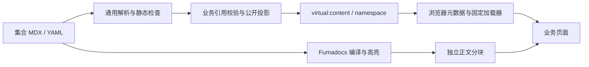

# Website 通用内容渲染

Website 的仓库内容通过通用 Fumadocs 编译链路接入 SPA。每个业务集合独立定义字段、公开投影和引用语义，编译、资源处理及正文加载不依赖 About。当前使用者是 About；后续 Website 栏目可以注册新的 namespace。

_最后更新：2026-10-12_

## 边界与数据流

`apps/web/build/content/` 是 Node 构建侧：解析 MDX/YAML、检查静态作者语法、验证资源路径、生成公开虚拟模块。`apps/web/build/collections.ts` 汇总注册集合，Vite 和 `content:check` 共用该列表。`apps/web/source.config.ts` 显式定义 Fumadocs 集合与编译 preset。

业务定义实现 `ContentDefinition`：namespace、root、文件分类/schema、作者组件属性契约及 `project(entries)`。通用引擎先解析全部文件，业务投影再校验跨引用；公开元数据与正文 import 不包含草稿。未注册文件使检查失败。图片资源采用有 src/alt/width/height 的 ImageRef 形态，不把任意业务 src 字段当作本地资源。

资源只从内容根 assets 目录导出；检查 realpath、存在性与路径边界。草稿独占资源不公开，公开内容共享使用的资源可以公开。内容目录不作为整个 public 目录复制。

开发期文件变化经同一校验后更新注册表并刷新页面。错误通过 Vite overlay 呈现，修复后恢复。构建配置变化遵循 Vite 自身的重启流程；生成目录不参与根测试 watcher。

## 浏览器与 UI

`apps/web/src/content/store.ts` 管理固定正文加载器，共享进行中的 Promise、缓存成功结果、移除失败以支持重试。`useContent` 在切换 id 或重试时立即呈现 loading，并隔离旧请求和卸载后的结果。

浏览器自身可能缓存失败的原生 import；移除应用 Promise 不能清除这个缓存。正文错误态除普通重试外提供重新加载当前页面，恢复整份 document 的模块状态，保留当前地址。不能只用可再次成功的测试 loader 推定网络失败恢复；需要在真实浏览器阻断 chunk 请求后验证恢复入口。

`apps/web/src/content/mdx.tsx` 提供可扩展组件映射。`packages/components/src/content/` 提供无路由/API 依赖的 CodeBlock、ContentImage、Callout、ContentProse。路由链接、业务按钮和资源 URL 由 Web 集合适配器注入。全局主题、ExUI CSS 和 ExMessage 宿主继续由既有应用入口持有。

高亮在构建期完成；浏览器不加载 MDX 编译器、Node 文件系统或高亮引擎。普通代码块从编译 transformer 接收原始文本，复制只作用于当前块。源码与维护记录见 `packages/components/src/content/SOURCES.md`。

## About 适配

`apps/web/build/about/` 持有社区、项目、成员、Media schema，固定页要求和引用图。`apps/web/src/content/about/` 适配注册表、语义目标和资源 URL；`apps/web/src/pages/AboutUs/` 持有页面布局、栏目目录、成员 Modal、Media 筛选与阅读位置。

About 入口及正文分别懒加载。成员只拥有正文 id，不创建个人路由；简介 Modal 不改变 URL。阅读位置按 Router location key 保存于模块内有限 Map，离开 About 再后退仍能恢复，页面刷新不持久化该状态。

静态内容不调用 Website Server、不新增 HTTP Contract 或数据库。现有 `/docs/` 仍归 Outline；文档搜索、侧栏和版本切换没有附带在这套基础渲染中。

编辑约定见 `.ai/knowledge/web/content-authoring.md`。实现证据来自 `tests/content/`、`apps/web/src/content/` 中的加载、真实 Fumadocs 编译和 Vite 更新测试；这些检查不替代认证、Outline 或部署验收。
