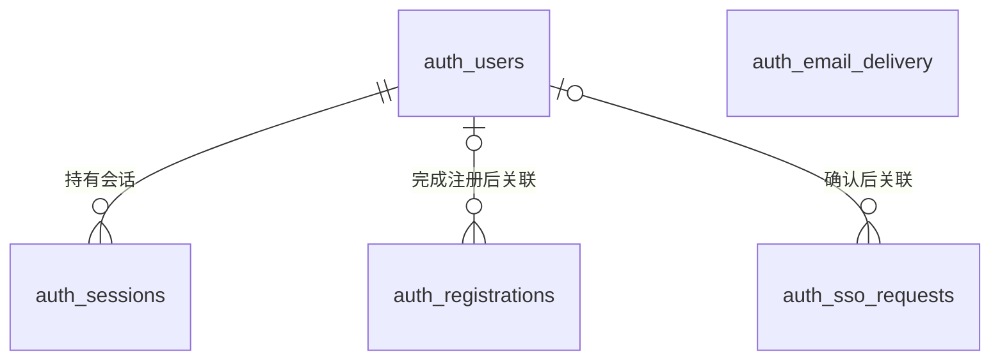

# 认证数据模型

本文件记录认证数据的业务职责、关系和跨实现必须保留的数据规则。它是修改模型前的设计入口，不代替可执行结构：当前 Mock SQLite 以 [`schema.ts`](../../apps/mock-server/src/db/schema.ts) 和 [`drizzle/`](../../apps/mock-server/drizzle/) 为准；HTTP 字段与行为以 [`api/openapi.yaml`](../../api/openapi.yaml) 为准。

_最后更新：2026-09-23_

## 适用范围

下图使用当前 SQLite 表名标识角色。表的职责、关系和数据规则是未来 PHP + MySQL 实现的目标业务模型；未来实现可以采用不同的物理表名、字段类型和索引。目前只有 Mock SQLite 的物理结构经过仓库代码验证，不能据此声称 MySQL 已有相同表结构。

`auth_email_delivery` 与其余表没有外键；它按邮箱保存发送冷却状态。`auth_registrations` 中的邮箱也不是指向 `auth_users` 的外键：验证完成前，账号可能尚不存在。

## 表的职责与关键规则

| 当前 SQLite 表 | 职责 | 关键标识与约束 |
| --- | --- | --- |
| `auth_users` | 保存验证完成的本站账号。 | `id` 标识账号；邮箱唯一，`nickname` 可重复；保存密码哈希而非明文。 |
| `auth_registrations` | 保存注册尝试、验证码校验状态及短期幂等结果。 | 注册标识和验证码均只存摘要；完成前不要求存在用户，完成后可选地关联 `auth_users`。状态限于 `pending`、`completed`、`cancelled`、`expired`，错误次数限于 0–5。 |
| `auth_email_delivery` | 按邮箱维护验证码发送冷却。 | 邮箱是主键；与注册尝试和用户均无外键。 |
| `auth_sessions` | 保存普通登录产生的本站会话。 | token 只存摘要；每条会话必须关联一个用户，记录到期与撤销状态。 |
| `auth_sso_requests` | 保存由本地 CLI 创建、等待浏览器确认的短期 SSO 请求。 | 请求标识以摘要作为主键；状态限于 `pending`、`completed`；确认前可无用户，确认后关联用户；完成 SSO 不创建本站会话。 |

注册尝试在完成、取消或到期后清除不再需要的敏感材料；会话不会因使用而续期。这些状态转换与清理行为见 [认证生命周期](../architectures/mock-server/authentication-lifecycle.md)。数据库文件、迁移和重置的操作边界见 [数据库生命周期陷阱](knowledge/database-lifecycle-traps.md) 与 [显式迁移决策](decisions/03-database-changes-only-by-explicit-command.md)。

## 修改模型时

当表的职责、关系或数据规则变化时，先更新本文件并评审其对 SQLite 与未来 MySQL 目标模型的影响，然后修改实现侧的 schema 和 migration。纯索引调整、迁移实现改动及测试数据变动不需要改写本模型。实际字段、约束和迁移仍需以实现侧文件核对，避免把本文当作第二份物理 schema。
