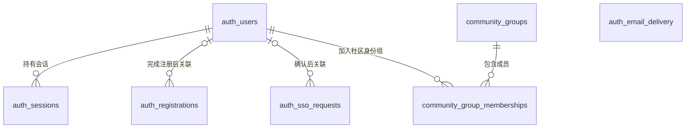

# 账号资料数据模型

本文件记录认证数据的业务职责、关系和跨实现必须保留的数据规则。它是修改模型前的设计入口，不代替可执行结构：当前 Mock SQLite 以 [`schema.ts`](../../apps/mock-server/src/db/schema.ts) 和 [`drizzle/`](../../apps/mock-server/drizzle/) 为准；HTTP 字段与行为以 [`api/openapi.yaml`](../../api/openapi.yaml) 为准。

_最后更新：2026-09-23_

## 适用范围

下图使用当前 SQLite 表名标识角色。表的职责、关系和数据规则是未来 PHP + MySQL 实现的目标业务模型；未来实现可以采用不同的物理表名、字段类型和索引。目前只有 Mock SQLite 的物理结构经过仓库代码验证，不能据此声称 MySQL 已有相同表结构。

`auth_email_delivery` 与其余表没有外键；它按邮箱保存发送冷却状态。`auth_registrations` 中的邮箱也不是指向 `auth_users` 的外键：验证完成前，账号可能尚不存在。

## 表的职责与关键规则

| 当前 SQLite 表 | 职责 | 关键标识与约束 |
| --- | --- | --- |
| `auth_users` | 保存验证完成的本站账号和基础资料。 | `id` 标识账号；邮箱唯一，`nickname`、QQ 与 FiveM ID 可重复；QQ、FiveM ID 和头像引用可为空；保存密码哈希而非明文。FiveM ID 是未经验证的用户声明，不用于认证或授权。头像引用是服务端生成的内部标识，每个已引用的对象只属于一个用户，图片字节不进入数据库。 |
| `auth_registrations` | 保存注册尝试、验证码校验状态及短期幂等结果。 | 注册标识和验证码均只存摘要；完成前不要求存在用户，完成后可选地关联 `auth_users`。状态限于 `pending`、`completed`、`cancelled`、`expired`，错误次数限于 0–5。 |
| `auth_email_delivery` | 按邮箱维护验证码发送冷却。 | 邮箱是主键；与注册尝试和用户均无外键。 |
| `auth_sessions` | 保存普通登录产生的本站会话。 | token 只存摘要；每条会话必须关联一个用户，记录到期与撤销状态。 |
| `auth_sso_requests` | 保存由本地 CLI 创建、等待浏览器确认的短期 SSO 请求。 | 请求标识以摘要作为主键；状态限于 `pending`、`completed`；确认前可无用户，确认后关联用户；完成 SSO 不创建本站会话。 |
| `community_groups` | 保存本站社区身份组的稳定标识和展示名称。 | `code` 唯一且稳定；首个系统保留组是 `general`（“通用”），展示名称不参与成员关联。默认组不授予权限。 |
| `community_group_memberships` | 保存正式用户与社区身份组的多对多关系。 | 用户与组的组合唯一，且双方必须存在；每个正式用户都应有一条 `general` 成员关系，待验证注册尝试没有成员关系。 |

注册尝试在完成、取消或到期后清除不再需要的敏感材料；会话不会因使用而续期。这些状态转换与清理行为见 [认证生命周期](../architectures/mock-server/authentication-lifecycle.md)。数据库文件、迁移和重置的操作边界见 [数据库生命周期陷阱](knowledge/database-lifecycle-traps.md) 与 [显式迁移决策](decisions/03-database-changes-only-by-explicit-command.md)。

本地 Mock 的头像字节保存在固定的 `apps/mock-server/data/avatars/`，数据库只保存引用；未来 PHP + MySQL 实现改用 COS 对象和公开 HTTPS 链接。两种实现都必须保证本人资料读取不泄露给匿名调用方，公开图片读取不包含邮箱，且清除或替换头像后旧引用不可继续公开读取。文件写入与数据库事务不能共同原子提交，因此先写完新文件、再提交引用，最后清理旧文件；失败时可能留下待显式核对的孤立文件，但不能留下指向未写完文件的引用。

社区身份组是本站账号关系，不映射游戏角色或 FiveM 权限。`general` 成员关系在正式账号创建的同一事务中写入；现有正式用户由显式增量迁移一次性回填。数据库外键和组合唯一约束防止孤立及重复关系，“每个用户都有默认组”还需由迁移、注册事务和验证共同维持。当前没有组管理、移除默认组、权限判断或 HTTP 组信息入口；未来 MySQL 实现也须保持这些业务规则，物理结构另行决定。

## 修改模型时

当表的职责、关系或数据规则变化时，先更新本文件并评审其对 SQLite 与未来 MySQL 目标模型的影响，然后修改实现侧的 schema 和 migration。纯索引调整、迁移实现改动及测试数据变动不需要改写本模型。实际字段、约束和迁移仍需以实现侧文件核对，避免把本文当作第二份物理 schema。
