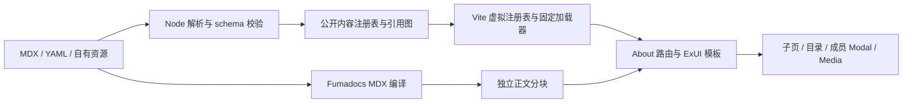

# RFC：Exre About 内容层与页面接入

日期：2026-10-12。状态：用户已确认通用内容层与 About 本地实现范围。模块根：`.notes/about-us/`。

设计依据：用户已确认 `.notes/about-us/specs/2026-10-12-about-us-design.md`。源 spec 保留原样；本 RFC 细化其实现契约，不代表生产实现、技术提案批准或上线验收。

## 1. 决策摘要

在现有 Website SPA 中增加 About 页面。以 Fumadocs MDX 常规配置编译仓库内容，用构建时内容注册表完成元数据、资源和跨内容引用校验；浏览器读取精简注册表，通过固定模块加载器按需取得正文。首页、子页、B 栏目导航、成员 Modal 与 Media 均由 ExUI 和 CSS Modules 实现。

保留 Vite、声明式 BrowserRouter、唯一 ThemeProvider、现有 RootLayout 和 Fastify。静态 About 不新增 HTTP Contract、数据库或后台服务。文档组件只在确有使用时选取 Fumadocs UI 源码适配，不安装完整 UI 主题/布局，也不引入 Next.js。

## 2. 当前证据与约束

| 当前事实 | 仓库证据 | 本 RFC 的约束 |
| --- | --- | --- |
| Web 是单一声明式 BrowserRouter SPA | `apps/web/src/main.tsx`、`apps/web/src/App.tsx` | 增加嵌套路由，不迁移为 Data Router 或 Next.js。 |
| RootLayout 持有全站导航、登录、设置与通知 | `apps/web/src/routes/RootLayout.tsx` | About 只持有栏目、正文与成员简介状态。 |
| SiteHeader 入口为 `/about`，手机导航按精确路径选择 | `packages/components/src/SiteHeader.tsx` | 修正入口和 About 前缀匹配，保留布局与账号槽位。 |
| 全站顶栏已吸顶 | `packages/components/src/SiteHeader.module.scss` | B 栏目栏随内容滚动，不再增加第二层 sticky。 |
| ExUI 样式、主题和临时通知宿主只有一个入口 | `apps/web/src/main.tsx`、`.ai/knowledge/web/exui-integration-traps.md`、`.ai/rules/frontend-notifications.md` | 不添加 Fumadocs RootProvider、Toaster 或重复 Token 样式。 |
| Vite 有定制代理、开发入口、安全头与 React dedupe | `apps/web/vite.config.ts` | 增量接入编译插件，禁止用模板覆盖配置。 |
| Web TypeScript 目前仅包含 src 和 Vite 配置 | `apps/web/tsconfig.json` | 新增 build/config 的显式类型检查范围。 |
| 根 Vitest 未转换 MDX，测试监听不含 content 目录 | `vitest.config.ts`、`scripts/runtime/tests.mjs` | 纯逻辑测试不导入 MDX；另测真实编译，补内容监听范围。 |
| Outline 不属于 pnpm workspace，拥有 `/docs/` | `pnpm-workspace.yaml`、`.ai/architectures/overview.md` | About 不修改 Outline；未来插件文档保留不同路径。 |

隔离审查见 `.notes/about-us/reviews/2026-10-11-fumadocs-integration-audit.md`：常规集合配置、`macro: false`、`updateViteConfig: false` 已在同主要前端版本的样例中通过编译、浏览器和内容热更新检查。独立 YAML meta Macro 在当时版本浏览器初始化失败，已排除。下面新增的注册表、真实页面、引用校验与源码组件适配尚未实施或验证，不能由该样例推定通过。

## 3. 范围与成功条件

本 RFC 覆盖 spec 的全部 About 页面和内容更新路径，采用一个 RFC，因为路由、注册表、模板与成员加载相互依赖。

成功条件是：编辑内容可开发预览与重新构建；无效内容阻止发布构建；有效子页可导航、刷新和后退；浏览器首页没有全部正文、Node 编译工具或重复 UI 运行实现；浅深色、键盘、目录和成员 Modal 符合已确认体验。

商店交易、插件文档完整布局/搜索、SSR、CMS、身份/数据库变更不属于实施范围。预留可复用接口不等于预先实现这些系统。没有数据库迁移、数据回填或 API 兼容窗口。

## 4. 模块与依赖边界

### 4.1 拟新增目录

| 路径 | 职责 |
| --- | --- |
| `apps/web/content/about/` | 已批准的 MDX、Media YAML 与自有资源，沿用 spec 目录。 |
| `apps/web/source.config.ts` | Fumadocs 集合配置；只在构建工具中消费。 |
| `apps/web/build/content/schema.ts` | 通用图片、文本与 URL schema；业务 schema 位于 `apps/web/build/about/schema.ts`。 |
| `apps/web/build/content/compiler.ts`、`syntax.ts` | 通用文件解析、静态语法与资源校验；不执行正文。 |
| `apps/web/build/about/definition.ts` | About 集合分类、两遍引用校验与公开投影。 |
| `apps/web/build/content/plugin.ts`、`preset.ts` | 通用 Vite 虚拟模块、加载器、开发更新及编译 preset。 |
| `apps/web/build/collections.ts` | Website 集合登记，供 Vite 与 CLI 共用。 |
| `apps/web/build/content/check.mts` | 可独立执行的内容校验 CLI。 |
| `apps/web/build/content/check.mjs` | Node ESM 启动包装，加载并调用 check.mts 的校验函数。 |
| `apps/web/src/content/about/types.ts` | 浏览器可消费的纯 TypeScript 契约，不导入 schema。 |
| `apps/web/src/content/about/registry.ts` | 虚拟模块适配、实体/地址查询与成功加载缓存。 |
| `apps/web/src/content/store.ts`、`useContent.ts` | 通用正文加载、重试、过期请求隔离。 |
| `apps/web/src/pages/AboutUs/` | AboutUs、页面模板、栏目导航、面包屑、成员 Modal、MDX 映射与 CSS Modules。 |
| `packages/components/src/content/` | 无路由/API 依赖的 CodeBlock、ContentImage、Callout、ContentProse。 |

第一版不新增 workspace 内容包。Node 构建侧可以用 `import type` 引用浏览器契约，浏览器不能反向导入 `apps/web/build/`。React 的 MDX 内容组件映射与页面路由属于 Web，不能放入公共 schema 或通用组件包。

### 4.4 用户确认的通用层修订

本节取代本 RFC 中将解析、插件和加载核心放在 About 专用目录的安排。`apps/web/build/content/` 保持通用：集合定义、MDX AST 静态检查、资源检查、虚拟模块插件与编译扩展不依赖 About。About 的 schema、文件分类、引用规则与公开投影放入 `apps/web/build/about/`。`apps/web/source.config.ts` 只汇总集合和通用编译 preset。

`apps/web/src/content/` 提供 `createContentStore(loaders)`、`useContent(store, id)` 和基础 MDX 映射；`apps/web/src/content/about/` 只适配 About 注册表和语义引用。`packages/components/src/content/` 提供 CodeBlock、ContentImage、Callout 和 ContentProse，无路由和 API 依赖。图片由 Web 映射公开资源地址；内部链接、MemberButton、Timeline/Milestone 由集合注入。

集合定义包含稳定 namespace、内容根目录、文件分类/schema、静态作者组件属性契约，以及两遍业务校验/公开投影函数。通用核心返回公开文档列表、资源表与序列化元数据；Vite 以 `virtual:content/<namespace>` 生成公开元数据及固定动态 import。新集合注册需要修改 Web 配置，不会自动公开任意目录。一个非 About 夹具集合必须经过同一编译链路验证通用性。

检查命令为 `pnpm --filter @workspace/web content:check`，统一检查当前注册集合。开发监听整个 `apps/web/content/` 和内容构建适配目录；正文、元数据、资源变动后重检并刷新相关内容，失败进入 Vite 错误覆盖层，修复后恢复。源码组件采用独立 ExUI 实现，保留 Fumadocs 编译属性兼容及来源记录，不复制未使用的上游 UI 代码。

### 4.2 依赖选择

- `fumadocs-mdx`、所需 `fumadocs-core`、`@types/mdx` 为 Web 内容编译能力；实际声明位置按构建/运行消费者区分。浏览器不导入 `fumadocs-core/source` 或生成的 server 内容入口。
- 使用现有 Zod 4；Node 侧 YAML 读取依赖 `yaml`。MDX frontmatter 使用 `gray-matter` 配合显式 YAML 引擎；MDX 语法树读取使用 `@mdx-js/mdx` 的解析能力与 `unist-util-visit`。这些是构建依赖，不进入浏览器。
- MDX 15.4.7、Core 16.17.1 为已完成隔离实验的候选锁定版本。实施接入时先核对 registry 与 peer 约束，按候选精确锁定；若换版本，重跑审查中的兼容探针，不能悄悄改成 Macro。
- 不增加 Next.js、完整 `fumadocs-ui` 运行依赖或第二份 Radix、Sonner、Base UI。若源码组件的某个公共 helper 确实需要 Core，限定到已核验的浏览器安全子入口并检查输出。
- 不复用临时审查的本地绝对 alias；ExUI 保持 registry 发布包和当前单实例 dedupe。

实施者必须显式声明直接使用的构建依赖，不能依赖 pnpm 的偶然提升或其他包的传递依赖可达性。版本、peer 和许可在安装前核验并留在 lockfile 与源码来源记录中。

### 4.3 数据流



校验和编译均在 Web 构建/开发工具进程中完成，直接读取仓库文件，不向 Website Server 请求内容。浏览器仅接收序列化的公开元数据、资源 URL 和正文模块。

## 5. 内容文件契约

本节是拟实施的内容契约。所有 schema 使用严格字段检查；错误给出仓库文件、字段和原因。编辑指南与样例必须使用同一契约。

### 5.1 通用值

| 类型 | 约束 |
| --- | --- |
| `Slug` / Media `id` | 小写 ASCII kebab-case，匹配 `^[a-z0-9]+(?:-[a-z0-9]+)*$`；不得为保留的 `index`。 |
| 文本 | 必需字段 trim 后非空；保留正文换行，不从文件名生成事实。 |
| `order` | 非负安全整数，默认 0；同序按稳定 slug/id 排序。 |
| `draft` | 布尔值，默认 false。草稿参与结构校验，排除于公开注册表、加载器和资源引用集。 |
| 外链 | HTTPS URL，无用户名/密码；不接受脚本、data URL 或任意 iframe。第一版不提供自定义协议入口。 |
| `ImageRef` | `src`、`alt`、`width`、`height` 必需；宽高为正安全整数。可选 `caption` 与 `position`。 |
| 图片路径 | `src` 为相对内容根的 `assets/<file>`，无父目录跳转；存在且 realpath 位于资源目录内。支持本地 PNG/JPEG/WebP/AVIF/SVG。 |
| 裁切位置 | `position` 为 `{ x, y }`，两个值均为 0–100 的百分比，默认居中。 |

内容插图的 `alt` 必须非空。装饰品牌图形由模板自身声明，不需要作者用空替代文字绕过内容图片校验。图片宽高是作者提供的布局信息；构建校验有效值与文件存在，真实比例和视觉裁切在浏览器核对，不宣称已自动校验图片所有编码信息。

实体 slug 必须等于文件 basename；这样重命名的影响显式可见。Media id 与时间线节点 id 在各自集合唯一；不同集合可以有相同 slug，由类型区分引用。

### 5.2 页面与实体 frontmatter

| 集合 | 必需字段 | 可选字段与默认值 |
| --- | --- | --- |
| 固定介绍页 | `title`、`description` | `eyebrow`、`draft=false` |
| 首页 | 固定页字段、`hero.headline`、`hero.summary`、`introHeading` | `hero.image`、`hero.eyebrow`、`entryDescriptions` |
| 社区详情 | `title`、`description`、`slug`、`status` | `order=0`、`draft=false`、`cover`、`related`、`joinUrl` |
| 项目详情 | `title`、`description`、`slug`、`status` | `order=0`、`draft=false`、`cover`、`related`、`publicUrl` |
| 成员简介 | `title`、`slug`、`role`、`summary`、`kind` | `order=0`、`draft=false`、`avatar`、`related`、`links=[]` |

固定介绍页是 `index.mdx`、`communities/index.mdx`、`projects/index.mdx`、`team.mdx`、`story.mdx` 和 `media/index.mdx`。这些页必须存在且为公开状态，保证六个固定导航入口成立；如果某栏暂无条目，保留介绍和清楚的空态。`draft: true` 适用于实体/媒体草稿，固定页被标为草稿时校验报错。

社区 `status` 为 `active | archived | planned | unknown`，项目为 `concept | development | released | archived | unknown`。`unknown` 渲染明确的「状态待补充」，而非 active/released。初始 CAEP 内容使用 archived；Rifling-911 的现状由作者提供真实资料，缺少时用 unknown。

成员 `kind` 为 `member | contributor`。成员描述使用 `summary`，注册表将其投影为简介；不要求作者重复维护 `description`。成员 `links` 为 `{ label, url }[]`，外链规则同上。

`entryDescriptions` 仅用于首页五个入口的短说明，键限于 `communities | projects | team | story | media`；未覆盖的项采用栏目介绍页的 description。标题和栏目路径由模板与注册表确定，避免在内容里复制路由定义。

`joinUrl` 只允许 active 社区使用，可以是已经存在的内部加入路由或 HTTPS 公开入口；archived/planned/unknown 携带加入入口时构建报错。初始内部加入目标限于现有 `/join/rifling-911`。未来商品或插件文档路径不作为当前项目 frontmatter 的有效目标；尚未存在时使用普通正文说明，不发布无效按钮。

### 5.3 Media YAML

`apps/web/content/about/media/items.yaml` 的根结构是 `{ items: MediaItem[] }`。每项为：

```ts
type MediaItem = {
  id: string
  type: 'music' | 'video'
  title: string
  creator: string
  usage: string
  order?: number       // 默认 0
  draft?: boolean     // 默认 false
  sourceUrl?: string   // 缺失时显示来源待补充
  cover?: ImageRef
  related?: RelatedRefs
}
```

条目不包含媒体二进制、播放器代码、iframe 或商品信息。`usage` 讲使用场景与选择理由；来源存在时用明确外链动作。Media 筛选是本页内存状态，不修改路由或浏览器历史；离开后重新进入默认「全部」。

### 5.4 引用与时间线

`RelatedRefs` 为可选的 `communities: Slug[]`、`projects: Slug[]`、`members: Slug[]`、`media: string[]`、`milestones: string[]`，每个数组不得重复。公开内容引用的目标必须存在且公开。草稿之间可以引用存在的草稿；缺失目标仍报错，不把 draft 当作跳过所有校验的开关。

历程正文使用 `<Timeline>` 与 `<Milestone id="..." dateLabel="..." title="...">`。id 为稳定 Slug；dateLabel 是真实日期/时间范围或明确的「时间待补充」，不自动转成 Date。可选 related 与图像遵循同一内容契约。节点 id 生成 `milestone-<id>` DOM 锚点，其他页的关联解析为 `/aboutus/story#milestone-<id>`。

普通 Markdown 标题从 `##` 开始，禁止正文 `#`。必要的手动锚点使用明确支持的组件属性，校验唯一性；不依赖未经约定的自动标题 slug 作为跨内容契约。

## 6. MDX 作者与模板契约

### 6.1 内容与布局分工

首页模板从 frontmatter 读取首屏与简介标题，将首页 MDX 正文作为简介正文，再按固定顺序呈现社区、项目、团队三张主入口和 Media、历程两个次入口。因此编辑标题、段落与入口说明不需要复制 React 布局；首页 MDX 不再自行重复渲染 Hero 或栏目导航。

列表页从 index/team 的 MDX 获取介绍，从集合元数据获取条目。详情页由模板渲染 h1、描述、面包屑，再渲染 MDX 正文及 related。成员正文独立渲染在 Modal body；成员 title 和 role 由 Modal header/介绍区负责。Media 页由 MDX 提供页首介绍，YAML 提供过滤条目。

### 6.2 公开作者组件

| 组件 | 作者契约 | 作用 |
| --- | --- | --- |
| 标准 Markdown 元素 | 段落、h2–h4、列表、强调、表格、引用、链接、代码 | 可编辑正文与统一排版。 |
| `ContentImage` | `image: ImageRef`，使用静态对象值 | 图片、比例、裁切、替代文字与图注。 |
| `AboutLink` | `target` 静态字符串 | `page:<fixed-key>`、`community:<slug>`、`project:<slug>`、`media:<id>`、`milestone:<id>` 的链接。 |
| `MemberButton` | `slug` 静态 Slug | 打开成员简介，按钮不是伪路由。 |
| `Timeline` / `Milestone` | 使用上一节字段 | 历程与稳定锚点。 |
| `Callout` | `title`、`kind: info | note`、children | 少量正文提示，不承载全站临时通知。 |

`page` 的固定 key 是 `home | communities | projects | team | story | media`。`media:<id>` 解析到 `/aboutus/media#media-<id>`；直接带该锚点进入时强制「全部」，内容加载后定位条目，避免过滤隐藏目标。

第一版正文不允许 import/export 声明或任意 JS 表达式；作者组件的标识、引用、图像对象和枚举均为静态可解析值。图像/related 对象只允许 JSON 形态的字符串、数值、布尔值、数组与对象字面量，不允许函数、变量、展开、计算属性或执行调用。组件映射由 Web 注入；组件白名单、静态属性和 link 节点通过 MDX AST 检查，遇到未知组件或表达式报出源码位置。正文不开放原始 HTML、事件属性或自定义脚本。这是仓库编辑契约，不是将 MDX 宣称为可安全执行不可信输入的沙箱。

普通 Markdown 外链限 HTTPS；内部 About 地址和锚点必须在注册表中存在。应用其他内部地址由小型允许列表验证，首版只包含真实需要的现有入口，不模糊接受任何以 `/` 开头的字符串。新增内部业务路径要在注册表适配配置中显式登记，仍不把 API 路由混入内容。

### 6.3 代码块

标准 fenced code 经 Fumadocs 构建时高亮，`pre` 映射到本地适配 CodeBlock。允许语言包含 Lua、JavaScript、TypeScript、JSON、YAML、Bash 与纯文本，统一处理 js/ts/sh 等别名；高亮之前的 remark 步骤将未知标签规范化为纯文本，保留原语言名称供标题显示，不能因新标签让整个构建失败。

本地适配保留上游 CodeBlock/Pre 的必要职责，使用 ExUI Button 与 `lucide-react`，CSS Modules 负责布局与高亮主题映射。高亮预设提供 light/dark 两套结果；背景/边框依旧来自 ExUI。升级或修改 mdxOptions 时显式保留高亮 preset，不能覆盖配置后静默丢失高亮。

复制使用当前代码块自己的原始文本，不能 `querySelector('pre')` 复制页面第一块。从编译 transformer 传递规范化原始字符串，不从行号或装饰 DOM 拼回代码。Clipboard 写入成功调用 `ExMessage.info('代码已复制')`，失败调用固定提示并允许手动选取。不在 SSR/模块初始化访问 Clipboard，不新增通知宿主。

第一版仅需普通代码块，不添加多语言文件 Tab、动态高亮或编辑器。适配源码的上游版本/文件、许可证、修改原因记录在组件旁的来源文档；不把本地维护等同于上游 UI 包自动升级。

## 7. 构建注册表与加载

### 7.1 注册表投影

Node 侧 `read.ts` 提取 frontmatter 和静态 MDX 引用/时间线节点，不求值正文。`validate.ts` 先建立所有实体、页面与锚点，再检验跨引用，避免文件读取顺序影响结果。公开投影只包含模板需要的字段。

浏览器接口采用如下语义，具体导出名与实现必须一致：

```ts
type AboutSection = 'home' | 'communities' | 'projects' | 'team' | 'story' | 'media'
type AboutPageBase = {
  id: string
  url: string
  section: AboutSection
  title: string
  description: string
}
type AboutPageRecord = AboutPageBase & (
  | { kind: 'home'; hero: HomeHero; introHeading: string; entryDescriptions: EntryDescriptions }
  | { kind: 'section'; key: Exclude<AboutSection, 'home'> }
  | { kind: 'community'; slug: string; status: CommunityStatus; cover?: AssetImage; related: RelatedRefs; joinUrl?: string }
  | { kind: 'project'; slug: string; status: ProjectStatus; cover?: AssetImage; related: RelatedRefs; publicUrl?: string }
)
type AboutMemberRecord = {
  id: string
  slug: string
  title: string
  role: string
  summary: string
  kind: 'member' | 'contributor'
  order: number
  avatar?: AssetImage
  related: RelatedRefs
  links: ReadonlyArray<{ label: string; url: string }>
}
type ContentModule = {
  default: React.ComponentType<{ components?: MDXComponents }>
}
type ContentLoader = () => Promise<ContentModule>
```

`HomeHero`、`EntryDescriptions`、两个 status 和 `RelatedRefs` 采用第 5 节字段，投影时补足默认值；没有 related 时使用空对象。`AssetImage` 用构建后 URL 替代源 ImageRef 的 src，保留 alt、比例、图注与裁切信息。成员独立于页面记录，不伪造个人 URL。普通列表字段 order 由集合摘要携带，页面记录本身只承担正文导航与渲染。

schema 推导类型与浏览器投影类型以类型检查断言一致，schema 仍只在 Node 执行；不使用一个容纳所有可选字段的对象掩盖错误。

注册表公开：固定栏目及页面、社区/项目/成员摘要、Media 条目、锚点与资源 URL。它不公开 Node 绝对路径、草稿或全部正文。内部页面 id 是固定路由或带集合前缀的 slug，不能由用户输入转换为磁盘路径。ContentImage 的静态相对资源标识通过公开资源映射解析为 AssetImage，不在浏览器读取文件系统。

### 7.2 Vite 虚拟模块

`about-plugin.ts` 提供 `virtual:exre-about-index`（只含元数据）与 `virtual:exre-about-loaders`（固定动态 import 映射）。源文件导入附带 Fumadocs 集合 query，例如 `?collection=aboutPages` 或 `?collection=aboutMembers`；不导入生成的 server 集合入口，不依赖 Macro runtime。

虚拟模块只为公开文档生成静态已知的 `() => import(<固定文件+query>)`，草稿根本没有 import。不要对全部 MDX 使用 eager glob，也不要先生成包含草稿的动态 import 后在运行时过滤——这仍会把草稿正文打进发布包。

资源通过 Vite 可分析的静态 URL import 输出，只导出公开引用的资源 URL；不存在图片时模板采用自有 fallback。构建不把 `content/` 当作整个 public 目录直接复制，因此草稿原文和未使用资源不会自动公开。About 模块懒加载后才取得注册表，首页之外的初始站点页面不要求下载全部 About 元数据。

生成 JavaScript 使用可靠字符串序列化，文件路径先规范化并通过根目录约束；不把 YAML 字符串拼成可执行代码或模块路径。按集合编译时复用 `schema.ts`，注册表和 Fumadocs 不能维护两份不同字段规则。

### 7.3 插件配置与开发更新

`apps/web/source.config.ts` 定义固定页、社区、项目、成员 doc 集合，以及 Media meta 集合，按 files pattern 排除不同集合的 index 重叠。文件分配表与所有受支持路径必须一一对应；未知 MDX 位置报错，避免忘记编译。

接入 `fumadocsMdx({ macro: false, updateViteConfig: false })`，放在 React 转换之前；原有 proxyBoundary、devEntry、resolve、server/HMR 与安全头保持其相对职责。插件 API 与配置加载路径在已锁定版本中核验。TypeScript 显式包含 `source.config.ts`、`build/content/` 与虚拟模块 `.d.ts`；`@types/mdx` 提供正文组件类型。

开发工具监视 About MDX、YAML、资源和 schema。纯正文修改交给 Fumadocs HMR；元数据、引用、draft、文件增删或资源图变化后重新构建注册表、失效相关虚拟模块，并请求开发页刷新，防止列表与正文不一致。校验失败显示 Vite 错误，不继续显示半新半旧的内容图；修复后恢复更新。

必要的 Fumadocs `.source/` 生成产物不作为手写源文件，精确加入忽略范围；注册表使用虚拟模块而非向 src 写文件。根测试 watcher 排除 `.source/`，避免编译输出触发循环。schema/config 编辑触发内容重检，配置失效要求开发工具重启时使用标准 Vite 行为，不私自重启 runtime 后台服务。

### 7.4 加载状态与重试

About 入口组件按路由懒加载；正文 `useContent(store, id)` 使用固定加载器并按 id 缓存成功模块。进行中的同 id 请求可以共享 Promise，失败必须清除缓存，允许重新请求。组件状态为 `loading | ready | error`；每次切换 id 或重试更新请求代号，响应只更新仍对应当前 id 和代号的视图。

标题、描述和必要封面比例从元数据先渲染。正文加载期间显示简短状态及占位，失败给出「内容暂时无法加载」与重试/返回入口，不展示原始堆栈。找不到 id 是 404，不当作可重试的网络错误。

点击正文重试不创建永远缓存失败的 React.lazy Promise，使用上述受控加载器。浏览器也可能保留失败的原生 import，因此正文错误态同时提供重新加载当前页面，保留当前地址并恢复 document 的模块状态。About 整个入口分块失败由边界提供重新加载当前页面的按钮及返回首页链接。刷新恢复后仍失败时不自动无限重试。

成功模块缓存不包含编译器或原始内容全集。开发 HMR 让相关缓存失效；生产模块与资源使用构建哈希，不以长生命周期 localStorage 缓存正文。

## 8. 路由、目录与阅读状态

### 8.1 路由表

`App.tsx` 在现有 RootLayout 下注册 `/aboutus/*`，懒加载 AboutUs 入口，通过已校验注册表解析首页、栏目和详情。动态详情只有公开注册表内的 id 可访问。固定页和 detail 使用不同模板；`*` 使用已有 NotFound，不重建第二套错误布局。

`/about` 使用 `<Navigate to="/aboutus" replace />`；这是 SPA 内的兼容跳转，不声称是 HTTP 301。规范 About 地址不以尾斜杠结尾，About 内部尾斜杠输入做替换式规范化；未知 slug 不先错误重写为有效页。

SiteHeader 的 About 激活判定为规范首页或 `/aboutus/` 前缀，同时保留 `/about` 跳转瞬间兼容；不能用裸 `startsWith('/aboutus')` 把 `/aboutus-other` 判为当前栏目。手机 Select 在任意 About 子页显示规范入口值 `/aboutus`。其余 Document/Gallery/Join/Community 的目标和当前状态沿用原逻辑。

### 8.2 栏目与面包屑

`AboutNavigation` 的六个目标来自固定栏目表，不能从所有内容文件随意生成 Tab。桌面使用 Link，首页精确匹配；community/project detail 选中对应父栏目，分别使用 spec 的 current page/location 语义。

手机使用受控 ExUI Popover，标题、description 与内容 accessible name 显式关联；PopoverTitle 本身不自动产生 ARIA 关系。链接选中、URL 改变、断点切换或离开 About 都关闭 Popover。按 Escape 关闭归还触发器；选择目的地后阻止关闭回焦抢占新页面标题，由页面导航效果完成焦点转移。

面包屑来自已校验页面关系，不从 pathname 文本猜测显示名。当前详情不可点击，其他祖先使用 Link。Popover 宽度受视口约束，不复制视觉伴侣的固定像素容器；手机断点按栏目的实际宽度验证并用 CSS 控制。

### 8.3 滚动、标题与焦点

声明式 Router 不引入仅支持 Data Router 的 ScrollRestoration。About 内提供轻量导航效果：以 `location.key` 记录阅读位置；PUSH/REPLACE 在正文标题就绪后进入页面顶部；POP 根据已记录位置恢复，无记录时从顶部开始。位置保存发生在切换前，不能把新页滚动误存给前一页。

普通导航时聚焦新页 h1（`tabIndex=-1`、`preventScroll`），再按规则滚动；后退恢复不强制抢走用户焦点。带有效锚点的访问在目标内容 ready 后定位锚点，预留全站顶栏遮挡高度。图片保留尺寸，长内容 POP 必须等待可恢复的高度，再恢复并校正；不要用固定延时猜正文何时加载。

与旧页面的边界要明确：About 首次进入没有保存位置时从顶部开始，离开时释放监听并恢复此前的 `history.scrollRestoration` 设置。StrictMode 挂载/清理可重复执行，不遗留重复监听或两个滚动所有者。

页面 title 和 description 使用元数据在 About 内设置，离开时恢复前值；不创建第二份全站主题或 document 管理器。不宣称这些客户端元数据能替代 SSR/分享卡片。

## 9. 成员与 Media 运行状态

### 9.1 成员 Modal

AboutPageView 持有 `{ slug, trigger, path }` 与 `openMember(slug, trigger)` 回调，团队卡片、项目关联和 MemberButton 都调用它。状态不放入全局 auth/settings/notifications，不改变 URL，不请求业务 API。

用户打开成员时，先显示已知 title/role，再按 id 加载简介；loading/error 只在 body 呈现，关闭始终可用。快速先开 A 再开 B、关闭后旧请求完成，都不能覆盖当前选择。关闭清空当前选择，成功模块可在成功缓存复用；不缓存失败。

使用 ExUI Modal `size="md"`、必需 title 和中文 closeLabel，保留默认手机全屏与 body 滚动。父上下文切换路由时关闭 Modal；触发器仍连接且可见则关闭后归还焦点，否则交给新页标题/合理回退，不能向已卸载的元素聚焦。无操作 footer 不传内容。

### 9.2 Media

列表仅消费公开 Media 投影，`filter = all | music | video` 初始 all。过滤更新 aria-pressed、结果列表及空态，保留当前筛选按钮焦点。来源链接在用户点击时打开外部平台，使用明确名称；若另开窗口则附 `noopener noreferrer`。

封面图片失败换为类型占位；没有 sourceUrl 不显示播放器动作。关联 Media 锚点始终位于对应条目上；从其他页带锚点进入时 all 筛选保证目标可见。第一版没有音视频播放状态、媒体代理或自动预取第三方内容。

## 10. 样式、组件与维护

页面所有 CSS Modules 使用 ExUI 的颜色、边框、圆角和字体/缩放约定；不创建 About 全局变量体系。生产页面不包含原型工作台、模拟窗口外框、文件说明或主题切换按钮。主题直接继承唯一 provider，包含 system 模式，不在 About 保存独立偏好。

布局与字体、卡片和动效以批准 spec 为准；采用 rem/流体字号/网格，支持无图 fallback。正文表格、长代码与超长链接在自身区域换行或滚动，不让页面横向溢出。手机目录和成员 Modal 遵守 ExUI 的 Portal、焦点与滚动行为。

CodeBlock 的适配组件可以放入 `packages/components`，但不可读取 About 注册表、调用业务 API 或定义路由。其他 About 模板保持 Web 私有；Steps、Files、类型表等未来有实际消费者时再评估。升级依赖同时核对源码组件记录，不通过恢复本地 ExUI link/portal 解决差异。

## 11. 构建、测试与接受门槛

### 11.1 检查入口

拟新增 `pnpm --filter @workspace/web content:check`，执行独立 Node/TS 校验 CLI。Web build 在 Fumadocs 编译前运行同一校验逻辑；dev 在启动和内容图改变时运行，因此无效内容不会只在手工命令中被发现。

`content:check` 执行 `node build/content/check.mjs`。该 ESM 包装使用已安装 Vite 的 `runnerImport` 加载 check.mts，再调用导出的 `checkContent()`；设置 `configFile: false`、`envDir: false` 与明确 Web root，避免加载 Website 代理配置或环境秘密，不 listen 开发端口。函数返回校验结果，由包装设置退出码。当前 Vite 类型已声明 runnerImport，同时标为 experimental，因此保留锁定版本与 CLI 正常退出测试；不要求用户全局安装 tsx。

CLI 必须以非零退出报告错误，输出路径/字段/源码位置，不打印完整内容或运行秘密。实际检查函数为 `checkContent()`，遍历共享 `contentDefinitions`；无顶层执行副作用。包装负责捕获异常并退出，不能把整个 CLI 当作可 import 的普通模块。Vite 构建启动和开发更新调用同一 `readContent`。

纯逻辑测试放入现有 Vitest include 覆盖的 `apps/web/src/content/about/` 或 `tests/content/`；构建校验测试可以从 Node Vitest 导入 build 模块，不从浏览器模块导入 schema。不要把 Vitest 全局加上整个 Website MDX/Vite 插件，以免改变其他测试语义。另一个独立编译集成测试通过 Vite 实际转换和产物检查验证 MDX/query/schema/CodeBlock，不用替换被测编译器的 mock 宣称兼容。

根 `scripts/runtime/tests.mjs` 的 watch 目录补上 `apps/web/content/about` 和 `apps/web/build/content`；处理 `apps/web/source.config.ts` 文件变更，并排除 Fumadocs `.source/` 与其他生成目录。schema/注册表测试进入现有自动测试，不能只留手工浏览器脚本。

### 11.2 必须覆盖的行为

| 层级 | 验证内容 |
| --- | --- |
| 内容校验 | 必填/未知字段、slug 与文件名冲突、同集合重名、草稿过滤、公开引用草稿、丢失资源、越界路径、非法 URL、未知 MDX 组件/表达式、重复时间线 id、固定页缺失。 |
| 编译与产物 | 实际 MDX 正文、Media YAML、Lua 与其他代码块、light/dark 高亮、公开内容动态分块；草稿正文、Node fs、schema/Zod、高亮引擎与新增 UI 实现不进入浏览器输出。 |
| 加载状态 | 失败后再次请求、A/B 快速切换、卸载后完成、多个消费者共享成功缓存、入口分块失败与局部正文失败有恢复入口。 |
| 路由和导航 | `/about` 兼容、全部固定页、详情与 404、刷新深链接、前缀边界、手机 Select、栏目 current 与面包屑、PUSH/POP/锚点。 |
| 目录与成员 | 键盘、Escape、外部关闭、触发器回焦、导航后的标题焦点、跨断点关闭、不同成员正文、加载中关闭、长内容内部滚动、手机全屏。 |
| Media | all/music/video、无结果、缺失来源、封面失败、有效锚点和来源动作、无自动播放。 |
| 现有框架 | 登录/设置/通知仍工作，ExUI theme/light/dark/system、单实例 CSS/宿主、短长页与弹窗顶栏几何、集成代理 HMR。 |

实现后的自动门槛为内容检查、`pnpm typecheck`、`pnpm test`、`pnpm build`，再执行真实浏览器验收。数据库测试仍按仓库隔离流程运行；Docker 不可用或既有失败必须分别报告，不静默回退开发库。本次 RFC 文档工作不运行这些业务检查，也不创建新的测试基线。

真实浏览器至少覆盖 320/390/768px、桌面/宽屏、200% 缩放、长文案、缺图、reduced motion 与浅深/system 主题。浏览器输出模块检查不是仅搜索最终 minified 字符串，使用 bundler 模块清单和入口请求记录核对加载边界。体积变化记录实际结果，未有证据时不虚构硬预算。

## 12. 备选方案与取舍

| 方案 | 收益 | 代价与选择 |
| --- | --- | --- |
| 所有文案留在 React | 初期依赖少 | 不满足用户独立编辑 MDX/YAML；未采用。 |
| Fumadocs Macro + 完整 UI 布局 | 默认文档能力较完整 | 已发现特定 Macro 路径运行故障，且引入第二套主题/依赖边界；未采用。 |
| 全部内容 eager 导入 | 编程简单，列表易生成 | 正文与草稿可能进入首次包，隐藏条目不等于未发布；未采用。 |
| 常规 MDX 配置 + 构建注册表 + ExUI 模板 | 保留框架，校验引用，正文分块，内容可编辑 | 需要维护小型构建适配层和源码组件，采用。 |
| 先建公共内容 workspace 包 | 多个消费者时边界明确 | 当前只有 Website 使用，提前增加包与发布职责；待真实复用需求再评估。 |

## 13. 风险与检测

| 风险 | 应对 | 检测/停止条件 |
| --- | --- | --- |
| Fumadocs 版本/API 变化 | 精确锁版本，常规配置，浏览器/生产探针 | query、schema 或模块入口不兼容时停止接入，不转而迁移整个框架。 |
| 自建注册表与编译 schema 漂移 | 复用 schema，类型断言，实际编译测试 | 元数据与渲染输出不一致使测试失败。 |
| 草稿通过 glob、public 资源或静态 import 泄露 | 构建前过滤 import 图，资源仅按公开引用导出 | 产物中出现草稿正文或仅被草稿引用的资源，阻止交付；公开内容共享使用的资源可以导出。 |
| JSX/链接引用未被校验 | 受限作者组件与 AST 两遍检查 | 未知表达式、目标或组件报错。 |
| Node/高亮工具进入浏览器 | 浏览器与 build 目录隔离，仅 type-only 类型引用 | output 模块清单出现构建工具，阻止交付。 |
| 依赖配置破坏 HMR 或现有代理 | 保留 Vite 配置，关闭自动更新 | 集成代理导航/HMR失败，不以单独 vite dev 通过替代。 |
| 源码文档组件失去上游修复 | 记录版本/许可/本地变化，升级逐项对比 | 代码复制/主题/ARIA 回归测试。 |
| Portal 关闭回焦与路由聚焦竞争 | 区分 Escape 关闭与选择链接关闭 | 键盘回焦落到卸载元素或抢走新标题，阻止交付。 |
| 长内容回退滚动恢复不正确 | 按 location key 保存，等待可恢复正文高度 | 长页→短页→后退、带锚点和图片加载浏览器测试。 |
| Client meta 被误认为完整 SEO | 明确仅 SPA 元数据 | SSR/预渲染和分享卡片保持后续单独需求。 |

## 14. 落地顺序、切换与回退

先落地内容契约、校验/注册表和实际编译探针，再落地正文加载与模板，随后接 B 导航、成员 Modal、Media 和旧入口兼容，最后完成真实浏览器与框架回归。顺序由依赖关系决定，不要求在 RFC 阶段写生产代码或提交拆分计划。

依赖加入与锁定、Vite 插件、类型检查范围、内容/构建 watcher 和相关测试必须作为完整可验证范围交付。没有可用 About 路由时不要单独把全站入口改成 `/aboutus`。占位内容保持明确身份，草稿不进入公开产物，固定页可以先用已标注的占位介绍。

本阶段仅本地集成验收，不部署。未来发布按项目运行/交付规则另行授权；静态资源与 index 使用同一次构建产物，不能分开覆盖导致旧加载器请求已删除 chunk。

回退恢复上一份完整静态构建与相应依赖/配置/路由变更，保持原 `/about` 目标与 404 基线；若曾对外发布 `/aboutus`，保留一个能明确说明状态的入口或在后续发布方案中决定兼容，不能把“回退即恢复旧行为”声称为无损保留新地址。内容源文件保留，不删除历史素材或任何数据库。没有服务端/数据库迁移需要逆向执行。

## 15. 待实施核验与后续范围

没有需要用户重新选择的重大架构问题，也没有未分配的 `TBD`。以下核验由实施者在对应阶段完成，失败时记录证据并调整实现细节，不能静默改变已批准设计：

1. 依赖接入阶段：核对锁定版本、peer、许可、Vite query/配置加载与 CLI module loader；若当前版本不能满足受控导入图，重新做兼容探针。
2. 编译阶段：验证虚拟模块生成的固定 import、集合 files pattern、草稿剔除和元数据更新，而非仅采用以前的 eager/小样例结果。
3. UI 阶段：验证 ExUI Popover/Modal 的实际公开类型、导航关闭与焦点归还，确认已有边界内的 token/字体和响应式断点。
4. 内容阶段：用户逐步补真实介绍、状态、成员、日期与来源；缺少资料使用明确占位/unknown/draft，不阻塞布局工作也不虚构事实。

后续插件文档可复用 schema/编译适配、MDX 组件与代码块，但文档侧栏、搜索和版本化另行设计；`/docs/` 继续归 Outline。Tebex 商店可复用内容故事与关联，交易数据不进入 About YAML。SSR、SEO 预渲染、多语言内容与成员深链接均需独立需求，不附带在本次实现中。

## 16. 证据与本稿校验

批准 spec：`.notes/about-us/specs/2026-10-12-about-us-design.md`；兼容审查：`.notes/about-us/reviews/2026-10-11-fumadocs-integration-audit.md`。仓库证据见第 2 节及 `scripts/runtime/build.mjs`、`pnpm-workspace.yaml`。

上游参考：[Fumadocs Vite](https://www.fumadocs.dev/docs/mdx/vite)、[Collections](https://www.fumadocs.dev/docs/mdx/collections)、[Code Block](https://www.fumadocs.dev/docs/ui/components/codeblock)、[Rehype Code](https://www.fumadocs.dev/docs/headless/mdx/rehype-code)。这些资料用于核对构建插件、集合校验与源码组件入口，本 RFC 的注册表、状态机、校验策略和目录不是上游提供的默认架构。runnerImport 的现有导出与 experimental 标记来自安装的 Vite 类型声明；CLI 执行仍待实施验证。

本稿依技术设计质量清单完成自检：来源范围、框架与目录边界、契约/默认值、加载失败、兼容跳转、草稿公开边界、导航/焦点、测试监听、切换与回退均有明确行为。文档路径、代码块、内部证据文件及源 spec 未修改情况进行机械检查；实际编译、自动测试、浏览器集成与部署仍标为 NOT_EXECUTED。
