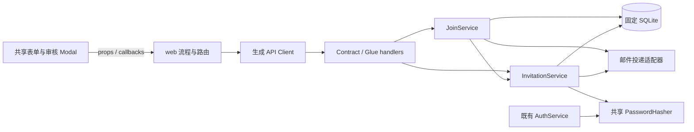

# RFC：申请审核与邀请注册

- 状态：待技术审阅；产品设计及本节所列后续修订已获用户确认
- 日期：2026-09-27
- 模块根目录：`.notes/join-registration/`
- 产品设计：`.notes/join-registration/specs/2026-09-27-join-registration-design.md`

## 1. 决策摘要与后续修订

以独立申请和邀请状态替换直接开放注册。新增 `/join` 分步申请页、临时申请审核页，以及邮箱 → 数字码 → 名字与密码的注册完善流程。普通登录、本人资料和 SSO 的公共行为保持现状。

**产品设计确认后的用户修订：本期临时审核页及其审核 API 不做身份验证或权限检查，不增加管理员初始化、授予身份或权限系统。** 用户后续另行实现权限系统。本修订替代源设计中“仅 admin 可操作”和“本地 CLI 初始化或授予管理员”的条款；源设计文件保留。

临时审核 operation 因此采用 `security: []`。本地 Mock Server 维持现有 `127.0.0.1:8080` 监听范围，审核人字段本期固定为 `null`，不得伪造管理员身份。该能力没有生产权限验收；后续权限系统须同时更新页面访问和服务端 Contract。

本 RFC 固化后续实现契约；此文档不修改当前 `api/openapi.yaml`，也不代表实现已完成。

## 2. 当前证据与约束

- `api/openapi.yaml` 当前版本为 `0.3.0`，直接注册包含启动、重发、取消、验证四个 operation。
- `apps/mock-server/src/auth/service.ts` 在注册启动时保存密码哈希，在数字码验证时创建账号；该生命周期不能承载审批后完善资料。
- `apps/mock-server/src/app.ts` 通过 Glue 注册 Contract，使用 `/api` 前缀，AJV 设置 `coerceTypes: false` 和 `removeAdditional: false`。
- `apps/mock-server/src/db/schema.ts` 已有账号、会话、SSO、资料及身份组结构；`apps/mock-server/drizzle/0005_implicit-ordinary.sql` 只建立 `admin` 组，没有初始化用户。
- `packages/components/src/auth/AuthForm.tsx` 已有 InputOTP 和 React Hook Form；表单必须遵守 `.ai/rules/frontend-forms.md`。
- 已安装 ExUI `0.6.0` 的公开类型包含 Dialog、Tabs、Field、InputOTP；不需要安装另一套 UI 实现库。
- 当前没有 `TESTING.md`。测试使用 Vitest、Testing Library、内存 SQLite 和真实 Fastify `inject()`，见 `tests/helpers/auth.ts`、`tests/contract/auth.test.ts`。

本期只操作固定的 `apps/mock-server/data/mock.sqlite`。数据库变更先更新并评审 `.ai/databases/data-model.md`，再修改 schema 与新增 migration。服务启动不迁移、不 reset、不创建账号。

## 3. 范围与验收目标

1. 任意未获同意的申请人均不能通过新 API 创建账号；旧直接注册路径不可用。
2. `/join` 三步收集邮箱、名字、QQ，全部必填；申请提交不产生账号。
3. 临时审核列表通过带两个 Tab 的 Modal 查看详情，同意、拒绝、重新发送邀请均可执行。
4. 邮件适配器在本地终端输出链接和 6 位码；链接可用 `email` 和 `code` 自动验证。
5. 验证通过后只填写名字、密码；账号 QQ 沿用申请，头像为空；完成后转到登录且不签发会话。
6. 过期、投递失败、重发、错误窗口、并发完成和成功重试有确定行为。

排除真实邮件服务、生产 PHP/MySQL、权限系统、管理员 CLI、通用后台、批量审核、申请编辑、动态表单编辑器、注册头像上传及昵称字符规则变更。

## 4. 职责与依赖

建议文件归属：

| 位置 | 职责 |
| --- | --- |
| `packages/components/src/join/` | 分步申请、确认提交、申请列表、详情 Dialog 与 Tabs；只接收值和回调 |
| `packages/components/src/auth/` | 邮箱输入、验证码、名字密码完善；保留登录及其验证码占位步骤 |
| `apps/web/src/join/`、`apps/web/src/pages/JoinPage/` | 申请流程、生成 Client 调用、页面说明 |
| `apps/web/src/invitations/` | URL 解析、短期凭证、注册完善流程 |
| `apps/web/src/pages/JoinReviewPage/` | 临时列表、详情载入、审核和重发状态 |
| `apps/mock-server/src/join/` | JoinService：申请提交、查询及审核事务 |
| `apps/mock-server/src/invitations/` | InvitationService：签发、验证码、完善凭证、建号、清理和邮件适配器 |
| `apps/mock-server/src/handlers/join.ts` | 新 operation 的薄 handler，不定义第二套 schema |

JoinService 与 InvitationService 共享同一 SQLite 连接；签发时使用同步的事务内部操作，不在 SQLite 事务中等待邮件或密码哈希。`apps/mock-server/src/server.ts` 构造一个 `ScryptPasswordHasher`，注入 AuthService 和 InvitationService，维持同一实例的两项并发、16 项等待队列预算。

AuthService 保留登录、会话和 SSO；移除旧注册方法、投递依赖和注册表清理。启动结构检查拆为现有认证结构与新加入结构；SSO CLI 只依赖其实际需要的认证结构，不 import migration/reset 入口。

## 5. 提议 HTTP Contract

下表路径均是 `api/openapi.yaml` 中不带 `/api` 前缀的路径。新对象均使用 `additionalProperties: false`，所有成功和错误响应使用 `Cache-Control: no-store`。

### 5.1 Operation 表

| Method / 路径 | operationId | 请求 | 成功 |
| --- | --- | --- | --- |
| POST `/join/applications` | `submitJoinApplication` | 邮箱、名字、QQ | 202 `JoinApplicationReceived` |
| GET `/admin/join/applications` | `listJoinApplications` | 列表 query | 200 `JoinApplicationList` |
| GET `/admin/join/applications/{applicationId}` | `getJoinApplication` | UUID 路径参数 | 200 `JoinApplicationDetail` |
| POST `/admin/join/applications/{applicationId}/approve` | `approveJoinApplication` | 空对象 `{}` | 200 `JoinApplicationDetail` |
| POST `/admin/join/applications/{applicationId}/reject` | `rejectJoinApplication` | 空对象 `{}` | 200 `JoinApplicationDetail` |
| POST `/admin/join/applications/{applicationId}/invitations` | `resendJoinInvitation` | 空对象 `{}` | 200 `JoinApplicationDetail` |
| POST `/auth/invitations/code` | `requestInvitationCode` | 邮箱 | 202 `InvitationCodeAccepted` |
| POST `/auth/invitations/verify` | `verifyInvitationCode` | 邮箱、6 位码 | 200 `InvitationVerified` |
| POST `/auth/invitations/complete` | `completeInvitationRegistration` | 完善凭证、名字、密码 | 200 `InvitationRegistrationCompleted` |

这九个新 operation 本期均为 `security: []`。既有受保护的本人资料、退出和 SSO 会话确认保留 Bearer security。

### 5.2 字段与响应

字段名继续采用 `email`、`nickname`、`qq`、`password`。复用当前 Email、Nickname、Password、VerificationCode、OpaqueIdentifier、SafeTimestamp；新增 UUID schema 与当前用户 UUID v4 规则相同。

| Schema | 必须字段及形状 |
| --- | --- |
| `JoinApplicationRequest` | `email: Email`、`nickname: Nickname`、`qq: string`，QQ 匹配 1–20 位数字 |
| `JoinApplicationReceived` | `status: const received` |
| `InvitationCodeRequest` | `email: Email` |
| `InvitationCodeAccepted` | `status: const accepted`、`serverTime: SafeTimestamp`、`resendAvailableAt: SafeTimestamp` |
| `InvitationVerifyRequest` | `email: Email`、`code: VerificationCode` |
| `InvitationVerified` | `status: const verified`、`completionToken: OpaqueIdentifier`、`email: Email`、`nickname: Nickname`、`serverTime: SafeTimestamp`、`completionExpiresAt: SafeTimestamp` |
| `InvitationCompleteRequest` | `completionToken: OpaqueIdentifier`、`nickname: Nickname`、`password: Password`；不接受 email、QQ、头像或验证码 |
| `InvitationRegistrationCompleted` | `status: const registered`、`email: Email` |

`JoinApplicationSummary` 的全部字段必有：`id`、`email`、`nickname`、`qq`、`status`（pending/approved/rejected）、`createdAt`、`reviewedAt`（时间或 null）、`reviewedByUserId`（UUID 或 null）、`invitationStatus`（active/expired/completed 或 null）、`deliveryStatus`（pending/sent/failed 或 null）。本期 `reviewedByUserId` 固定为 null，客户端不能填写它。

`JoinApplicationDetail` 必有 `application: JoinApplicationSummary`、`invitation: InvitationSummary | null`、`serverTime`。`InvitationSummary` 必有 `id`、`status`、`issuedAt`、`expiresAt`、`codeExpiresAt`（时间或 null）、`completedAt`（时间或 null）、`completedUserId`（UUID 或 null）、`resendAvailableAt`、`latestDelivery`（对象或 null）。最新投递对象只包含 `id`、`status`、`startedAt`、`finishedAt`（时间或 null），没有原始异常或数字码。

`JoinApplicationList` 必有 `items: JoinApplicationSummary[]`、`total`、`offset`、`limit`、`serverTime`；四个数值均为非负安全整数，limit 为 1–50。

列表 query：`view` 为 pending/all，默认 pending；`limit` 默认字符串 `20`，匹配 1–50；`offset` 默认字符串 `0`，匹配 0–999999999 的无前导零十进制数。由于现有 AJV 不转换 query 类型，这两个 query 字段在 Contract 中定义为有上述 pattern 的字符串，handler 校验后转数值。响应 offset/limit 为数值。不修改全局 AJV 行为。排序固定为 createdAt 降序、id 降序，前端切换视图回到 offset 0。

匿名提交不返回申请 ID。重复提交、已有账号和新申请均返回相同 202 形状。匿名发码不返回资格、投递结果、真实验证码到期时间或申请资料，始终返回统一接收形状；`resendAvailableAt = serverTime + 60 秒` 表示下一次客户端重发时间，不保证该次实际投递。

### 5.3 错误语义

全部使用既有 ErrorEnvelope 和 `apps/mock-server/src/errors.ts` 统一构造；在 `apps/mock-server/src/auth/errors.ts` 扩展现有 AuthError 的 code 与固定文案表，使当前错误链解析可以识别新错误，不引入无法被现有 handler 识别的错误类。HTTP 请求或异常日志不得记录 password、code、completionToken 或 HMAC。

| 情况 | HTTP / code | 行为 |
| --- | --- | --- |
| schema 不合法 | 400 / BAD_REQUEST | 既有 Contract 校验错误 |
| 审核申请不存在 | 404 / JOIN_APPLICATION_NOT_FOUND | 固定提示申请不存在 |
| 审核状态冲突 | 409 / JOIN_STATE_CONFLICT | 刷新详情，展示当前结果 |
| 已有账号影响审核或凭证完成 | 409 / EMAIL_IN_USE | 只有审核或有效完善凭证持有方可得到此结果 |
| 管理员重发不足 60 秒 | 429 / CODE_RESEND_TOO_SOON | Retry-After 为剩余秒数 |
| 无资格、码错误、码过期或码已消费 | 400 / INVITATION_CODE_INVALID | 统一“验证码无效或已过期，请重新获取”；不区分审批情况 |
| 错误窗口锁定 | 429 / INVITATION_CODE_LOCKED | Retry-After 为窗口剩余秒数 |
| 无效、过期或被替换的完善凭证 | 401 / COMPLETION_GRANT_INVALID | 提示重新获取验证码；不得清理当前本站登录 token |
| 密码资源队列已满 | 503 / AUTH_BUSY | 复用当前资源预算及 Retry-After |
| 请求频率过高 | 429 / JOIN_RATE_LIMITED | Retry-After 为限流窗口剩余秒数 |
| 非预期错误 | 500 / INTERNAL_ERROR | 统一安全文案，不回显原异常 |

匿名发码的无资格、冷却或投递失败都返回 202；真实异常如数据库不可用仍返回 500。审核动作成功但邮件投递失败返回 200，并在详情中明确 `deliveryStatus: failed`，避免把已提交审批误当作未审批。

## 6. 数据模型与新增迁移

本节是提议的本地 SQLite 物理结构；未来 PHP/MySQL 必须保持职责和业务约束，采用自身物理实现。

### 6.1 `join_applications`

| 列 | 约束 |
| --- | --- |
| id | UUID v4，主键 |
| email / nickname / qq | 规范化后的非空文本；QQ 保留前导零 |
| status | pending、approved、rejected，非空 |
| created_at | 非空安全毫秒时间 |
| reviewed_at | 待审核为 null，审核后非空 |
| reviewed_by_user_id | 可空 FK 到 auth_users；本期始终 null |

唯一部分索引：email WHERE status IN ('pending','approved')，使同邮箱仅有一个未拒绝的申请；拒绝历史不阻止重新申请。另有 status/created_at/id 的列表索引。CHECK 固定状态及 reviewed_at 与审核状态的对应关系。

匿名重提交不能覆盖名字、QQ 或审核结果。已有账号邮箱不插入申请。审核前后均不修改申请原始名字和 QQ，最终账号名字另存于 auth_users。

### 6.2 `join_invitations`

| 列 | 约束 |
| --- | --- |
| id / application_id | UUID 主键；非空 FK 到 join_applications |
| status | active、expired、completed，非空 |
| issued_at / expires_at | 非空；expires_at = issued_at + 7 天 |
| code_version | 从 1 开始，每次签发新码递增 |
| code_digest / code_expires_at | HMAC 摘要与时间，可空；消费或到期后清除 |
| completion_token_hash / completion_expires_at | SHA-256 摘要与时间，可空；token hash 唯一 |
| completed_user_id / completed_at | 可空 FK 到 auth_users 与时间；completed 时必须非空 |

唯一部分索引：application_id WHERE status = 'active'；另有 application_id/issued_at/id 和 expires_at 索引。过期更新后才能为同申请签发下一条 active 邀请。任何资格判断都比较服务端时间，不能只信已保存的 active 标签。

同邀请只有一个当前完善凭证。成功校验替换旧 token hash；重发数字码本身不替换已签发凭证。completed 状态保留 token hash 至其原到期时间，仅允许返回同一完成结果，不允许再次改密码或名字。

### 6.3 `join_email_controls`

email 为主键，无用户/申请外键；保存 `next_send_at`、可空 `failure_window_started_at`、0–5 的 `failed_attempts`。同邮箱的冷却与失败窗口跨验证码重发、邀请更新继续有效。

未知邮箱的验证错误也维护同样的短期窗口，以免锁定响应区分申请状态。清理时，仅删除没有有效邀请、冷却已结束且失败窗口已结束的控制记录。

### 6.4 `join_delivery_attempts`

保存 UUID id、invitation_id FK、code_version、started_at、可空 finished_at，以及 pending/sent/failed 状态。invitation_id/code_version 组合唯一。不保存验证码、注册链接、原始异常或邮件正文。

每次投递更新自己的记录；详情从当前邀请最高 code_version 的尝试取最新投递状态，迟到结果不覆盖后续尝试。管理员只读审核事实和结果，不读码或凭证摘要。

### 6.5 迁移与保留

通过下一条增量 Drizzle migration 创建新表、索引和约束；先将 `auth_email_delivery.next_send_at` 复制到新控制表，再 DROP 旧 `auth_registrations` 和 `auth_email_delivery`。旧注册尝试及其敏感材料随表移除，不转成获批邀请，不修改历史 migration。

auth_users、资料列、auth_sessions、auth_sso_requests、community_groups 和 community_group_memberships 保留。新账号不写身份组关系，QQ 来自获批申请，fivem_id 和 avatar_key 为 null。

申请、邀请和投递结果本期保留供测试核对，不提供删除 API。敏感摘要在码到期/消费、凭证到期/替换和邀请到期时清除；账号密码只在 auth_users 保存既有 scrypt 哈希。每次新流程请求限批清理 25 条到期状态，查询始终按时间计算有效状态，不依赖清理及时执行。

## 7. 事务、时钟和失败处理

### 7.1 申请与审核

提交申请在同步事务中检查已有账号和未拒绝申请，再插入 pending；唯一索引竞争按同一 202 结果处理。

同意只接受 pending → approved，在同一事务中写审核时间、邀请、验证码摘要、冷却和 pending 投递记录。拒绝只接受 pending → rejected。对已经执行相同决定的请求返回当前详情，不重复发送；相反决定返回冲突。并发同意/拒绝只允许一个决定提交。

有效邀请下管理员“重新发送邀请”只签发新码；过期邀请下，将旧邀请设 expired、清除其凭证，再创建新邀请获得 7 天有效期。已有账号或已完成邀请不能重发。审批投递失败不回滚审批。

### 7.2 发码与错误窗口

数字码来自安全随机整数并补足六位；新码不得与仍有效的旧码相同。HMAC 输入包含邀请 ID、code_version 和数字码，使用现有 AUTH_CODE_HMAC_KEY。浏览器输入只接受六位十进制数字。

验证码最长 10 分钟有效；code_expires_at 取 now + 10 分钟与 invitation.expires_at 的较小值。同邮箱 60 秒冷却覆盖审批、匿名继续、申请人重发和审核页重发，投递失败也不撤销冷却。

匿名发码在资格及冷却允许时提交新码和尝试记录，否则仍返回统一接收形状。返回结果不声明邮件已经送达。

首次格式合法但错误的码建立 10 分钟窗口；第五次错误立即产生锁定响应。正确码过期/消费或没有有效码的情况不作为错误猜测；没有资格的邮箱仍累计普通错误窗口。窗口结束后在下一次验证时重置。失败计数必须提交：事务返回判定结果，再在事务外抛业务错误，不能因抛错而回滚计数。

### 7.3 通过数字码

同步事务内检查错误锁定、申请已同意、有效邀请、码及邮箱，再消耗码，生成 32 随机字节的 base64url 完善 token，只保存 SHA-256 摘要。expires_at = min(now + 30 分钟, invitation.expires_at)。返回邮箱、申请原名字和凭证，不创建用户。

码只有一次消费机会。若验证响应丢失，用户从验证码页重新发码；不通过保存原始 token 来使数字码可重复换取凭证。新验证替换旧完善凭证，旧页面提交会收到失效提示。

### 7.4 完成注册

1. 校验完成输入和凭证，读取对应邀请，已有 completed 结果且同摘要未到期则直接返回原结果。
2. 使用共享 PasswordHasher 在事务外计算密码哈希；不得提前保存密码哈希到申请或邀请。
3. 同步事务重新检查当前时间、凭证摘要、邀请/申请状态和邮箱唯一性。
4. 写 auth_users，名字采用提交值、QQ 采用申请值；标记邀请 completed，消耗码，保留有限幂等摘要与结果。

哈希等待期间凭证失效、管理员更新邀请或其他完成请求获胜时，以事务复查为准。成功重试不能覆盖原账号资料。所有操作均不创建 auth_sessions；成功前后的现有登录 token 不参与注册完善授权。

### 7.5 邮件投递

投递适配器输入为 email、registrationUrl、code、invitationExpiresAt、codeExpiresAt、attemptId；服务端完成提交后调用，内存中持有明文码，不把它写入数据库。

适配器完成后标记 sent；拒绝、异常或 10 秒超时标记 failed。超时后迟到结果不得改回成功；允许后续重发新码。服务重启后，由后续新流程请求的限批惰性清理将超过 10 秒仍 pending 的尝试标记 failed，不恢复已丢失的明文码。服务启动只检查结构，不在启动时修复投递数据。

配置 `MOCK_PUBLIC_WEB_BASE_URL`：默认 `http://localhost:8081`，只允许完整 HTTP(S) 站点根地址，不含 credentials、query、hash。注册链接通过 URL API 构造 `/register?email=...&code=...`，不用请求 Host。本地 adapter 输出完整邮件内容；正式 adapter 接入时替换该依赖，不改前端 Contract。

### 7.6 资源控制

新流程四个匿名写 operation（申请、发码、验证、完成）共享基于实际远端 IP 的 60 次/分钟窗口，最多保存 1024 个 IP 项，过期优先清理并以 LRU 淘汰。沿用当前不信任转发头的设置，限流不按邀请资格变化。时间和限流器可注入用于确定性测试。

这项频率控制服务于本地资源预算，不实现权限判断或人机验证。现有图片验证码仍为占位，不将其视为新加入流程的防护证据。

## 8. 前端状态与组件契约

`/join` 位于 RootLayout 内。页面说明完整四阶段流程；申请 RHF 表单保持一个草稿，通过三个独立步骤组件展示当前字段。前进只校验当前字段，最终提交校验全部字段，后退保留值。刷新清空草稿；确认页是只读汇总，不新增资料字段。

`/register` 从旧 AuthPage 注册模式拆为 InvitationRegistrationPage，继续复用认证背景与容器。状态为 email、code、profile、registered，三个输入表单各自使用 RHF/Zod。流程状态、API 和 token 由外层控制；共享组件不使用 useState 保存字段。

URL 规则完全采用源设计：仅合法单值 email + code 才自动提交；email 单独存在直接显示 code；无邮箱或非法/重复参数进入 email 并提示错误。捕获参数后先 replace 清除所有 code 参数；数字码不写 location.state、日志或存储。

自动请求以一次入口读取为单位去重，初始参数先以纯读取方式取得稳定快照，再在 effect 中用 history.replaceState 清理 code，保留原 history.state，不通过修改路由 key 使组件重新挂载。用 ref 保存该次自动请求的 Promise；effect 的每次 setup 以新的响应代次订阅同一个 Promise，cleanup 使该次订阅失效，但不重新签发请求或永久丢弃 Promise。这样 StrictMode 的 setup/cleanup/setup 不会二次消费码，也不会忽略唯一一次成功响应。OTP onChange 不另发同一 URL 自动请求。真正卸载后内存自然释放；返回邮箱和流程切换时主动清理密码、数字码及 token，迟到响应通过代次拒绝。

状态 1 点击继续成功返回统一 202 后进入 code；网络错误留在 email。code 页重发返回 202 后清空原码并按 serverTime/resendAvailableAt 倒计时。429 验证锁定停留 code，显示倒计时，重发不绕过锁定。自动验证失败清空码，允许输入新码；网络失败也允许明确重试。

profile 页仅有 nickname、password 输入，邮箱是只读文字；不包含 QQ、头像、确认密码、图片验证码或邮箱编辑。nickname 从验证响应带入，密码不 trim。完成响应后立即清空凭证与密码，显示成功及“前往登录”按钮，1.5 秒后 replace 到 `/login`，通过内存路由 state 带入邮箱，不带 code 或 SSO 请求。

登录组件改用 onJoin 回调；RootLayout 关闭登录 Dialog 后 navigate `/join`。移除 AuthArea 的 onRegister、移动端注册选项、注册 Modal 模式和 AuthFlow 中旧注册分支，保留登录和 SSO 功能。共享包导出与所有消费测试同步更新。

审核页通过生成 Client 载入列表与详情；本期不调用 /auth/me 来判定访问资格。列表详情使用受控 Dialog，标题和描述提供可访问名称。Tabs 值为 application、review；内容区滚动，TabsList 与 DialogFooter 固定。关闭恢复触发项焦点，过滤/分页状态不清空。

详情每次打开刷新，选中项更换或关闭时通过请求代次拒绝迟到结果。审核成功采用返回详情并刷新列表；冲突先刷新详情。修改请求期间禁用重复按钮，关闭弹窗不取消已经提交的审批。审核人显示“未记录”，不显示伪造用户。Tab 扩展只加有实际内容的新分类。

样式使用 CSS Modules、ExUI 颜色/圆角 token 与 rem 布局；桌面 Join 保持已确认的说明/表单两栏，窄屏按说明在上、表单在下排列。Dialog 保持可视区域内高度、触摸滚动和可见底部动作。

## 9. 切换、回退与落地顺序

一次切换 Contract `0.3.0` → `0.4.0`。移除四条旧 `/auth/registrations` 路径及 operation/schema/handler，删除旧实现和旧测试入口；不提供过渡别名。既有账号、登录、SSO 和资料 Contract 不收紧。

落地依赖顺序：

1. 更新并评审 `.ai/databases/data-model.md` 的职责和关系。
2. 修改 Contract，执行 api:lint、api:generate，生成类型不可手改。
3. 同一个交付单元完成新 schema/migration、结构检查、服务和 handlers，同时退役旧注册。
4. 接入共享 UI、web 路由、URL 流程和临时审核页，并迁移既有测试夹具。
5. 完成测试、类型、构建和实际页面验证后，才允许显式迁移并运行候选版本。

不发布只有新 Contract、旧服务或旧前端的中间状态。更新 handler 双向覆盖和所有生成 Client 消费点。

迁移前停止 Mock Server，关闭数据库写入并用 SQLite backup API 生成固定工作区内的人工恢复备份；不直接复制仍运行的 WAL 数据库。备份不提交。验证账号、会话、SSO 和身份组关键行在迁移前后保持一致，并执行 foreign_key_check。

应用回退到旧版本会重新开放旧注册且缺少旧表，不能作为安全回退。迁移后优先修复候选版本；若必须回退，需要停止服务、明确接受回退后产生的注册数据损失，并用迁移前备份恢复数据库与对应旧应用。DROP 的旧注册敏感材料不可由 down migration 重建，不提供自动数据逆迁移。

全新环境：install → api:lint → api:generate → db:migrate → dev；匿名提交申请后直接打开临时审核页同意，即可完成首个注册。无管理员初始化步骤。

## 10. 验证计划

| 层次 | 必须覆盖 |
| --- | --- |
| Contract HTTP 与原始 handler | 九个新 operation、固定字段、no-store、额外字段拒绝、覆盖双向一致、旧四路径 404 |
| 申请/审核服务 | 去重不覆盖、拒绝后重申、相同决定幂等、相反决定冲突、无身份可测试审核、原审核人 null |
| 码与时钟 | 前导零、替换旧码、10 分钟/7 天边界、60 秒冷却、跨重发失败累计、锁定窗口结束、失败计数提交 |
| 完善事务 | 只在完成时建号、QQ 带入、头像为空、异步哈希期间失效、邮箱竞争、两个完成请求唯一建号、幂等不改密码 |
| 投递 | 成功/失败/超时、审批不回滚、冷却不撤销、迟到结果、重启 pending 恢复、不在响应/数据库泄漏明文 |
| 迁移 | 新库全 journal、既有库账号会话SSO组保留、旧表移除、约束和 foreign_key_check、结构不足时启动失败 |
| UI 行为 | 三步申请、确认回退、Join 独立页、注册三个状态、URL 非法/重复和清码、自动请求去重、重发锁定与刷新 |
| 审核 UI | 列表分页/过滤、Dialog 两 Tab、关闭焦点与列表位置、请求代次、投递失败展示、窄屏动作可见 |
| 回归 | 普通登录、存储异常、会话恢复/退出、SSO、本人资料和头像现有行为 |

`tests/helpers/auth.ts` 扩展新服务、时钟、随机源和邮件捕获；为登录/资料回归添加仅测试模块可用的用户夹具，不保留 AuthService 的旧注册方法作为测试后门。新业务测试完整经过申请、审核、验证、完善流程，认证回归可通过夹具初始化用户以避免重复测试所有申请步骤。

验证命令是 api:lint → api:generate → typecheck → test → build。实际浏览器另验桌面和移动端 Join、URL 自动验证、审核 Modal/Tab。设计文档阶段不运行或宣称实现测试通过；终端 adapter 验收不等于真实邮件送达。

## 11. 风险与选择

| 风险 | 处理与检测 |
| --- | --- |
| 临时审核无鉴权 | 用户明确选择本地测试流程；维持回环监听，不把它作为生产权限实现；Contract Test 明确记录公开行为 |
| 数字码在 URL | 读取即清除，在 `apps/web/index.html` 的脚本与资源前声明 no-referrer，不添加分析采集；未来入口访问日志须去除 code；仍接受邮件和原始入口请求持有码这一产品选择 |
| 邮件检查工具自动打开一次性链接 | 本期 Mock 没有真实邮件工具；未来正式邮件接入必须验证此风险，不能将后台预览访问自动执行 JS 的情况当作本地已通过 |
| 邮件事务与 SQLite 不可共同提交 | 先提交资格、记录尝试，再投递；失败可新码重试，具体尝试结果独立 |
| 消费码后响应丢失 | 页面提示重发；避免保存明文完善 token 来恢复消费结果 |
| 多标签旧凭证 | 新验证替换旧凭证，旧表单明确失效；事务复查防止双建号 |
| 迁移不可逆材料删除 | 停止写入后备份，切换单元完整验证；数据恢复与应用回退分开 |
| 后续更多申请字段 | 按字段/步骤模块扩展并显式修改 Contract；不提前接受任意 JSON 字段 |

选择独立申请/邀请职责，避免混合旧“先保存密码后验码”的注册尝试；代价是新增数据表与一次公共契约切换。选择同邮件和 URL 六位码是用户确认的交互，并不构成双因素验证。选择临时公开审核是最新用户修订，不引入假权限标志或临时管理员账号。

## 12. 未决项与交付边界

本 RFC 范围内没有未决产品选择或 TBD。权限系统、真实邮件、生产 PHP/MySQL 及其入口日志配置属于后续独立工作，本 RFC 的本地验收不覆盖它们。

产品设计原文件及视觉草图保留。设计知识提炼到 `.ai/` 需另行获得用户同意；实现前的数据模型更新属于仓库强制前置步骤。本文保持本地未提交，实施与提交须由后续任务分别授权。
